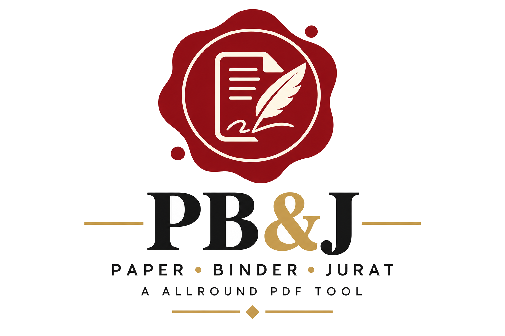

<p align="center"></p>

# PB&J Studio

**Paper, Binder and Jurat.** A Windows PDF app for everyday office work: open, fill, comment, merge,
organise, edit, redact, protect, export and sign PDFs. Its star feature is **Multi-Sign (DSC)**:
sign one PDF in many places in a single run, using a Digital Signature Certificate on a USB token.

Black-and-white interface. All code and icons are original.

---

# Part 1 - For everyone: install and use

## What you need

- Windows 10 or 11, 64-bit.
- For signing: your DSC USB token and its driver installed (the same driver your other signing
  software uses), and the token's PIN.

## Install

1. Download `PBJStudio-Setup-1.0.0.exe` from the **Releases** page of this repository.
2. Your browser may warn that the file "isn't commonly downloaded". This is normal for new free software
   without a paid code-signing certificate. In **Edge**: open Downloads (Ctrl+J), click the **...** next to the
   file, choose **Keep**, then **Show more** > **Keep anyway**. In **Chrome**: click the warning, then **Keep**.
3. Double-click the file. If Windows says "Windows protected your PC", click **More info**, then **Run anyway**.
4. Accept the licence and click **Install**. No administrator rights are needed.
5. Tick **Launch PB&J Studio** at the end, or start it from the Start menu.

To remove it, use **Settings > Apps > Installed apps > PB&J Studio > Uninstall**.

## Open a PDF

Use **File > Open**, drag a PDF onto the window, or pick one from the recent files list.
The program works on a private copy. Your original file is not changed until you **Save**
(Ctrl+S) or **Save As** (Ctrl+Shift+S). Every change can be undone (Ctrl+Z) and redone (Ctrl+Y).

## What you can do

| Tool | What it does |
|---|---|
| **Multi-Sign (DSC)** | Sign one PDF at many places in one run with your USB token. The app finds the places for you (signature lines, text such as "Authorised Signatory", empty boxes), or you click the places by hand. |
| **Comment** | Highlight, underline, strike out, notes, text boxes, shapes, freehand and stamps. |
| **Fill Forms** | Fill form fields and flatten them. |
| **Organize Pages** | Rotate, delete, extract, reorder, insert and split pages. |
| **Combine Files** | Merge PDFs, or turn images into a PDF. |
| **Edit** | Add text, images, watermarks, headers, footers and page numbers. |
| **Redact** | Permanently remove content (the text is removed, not just covered). |
| **Protect** | Add or remove a password (AES-256) and set permissions. |
| **Export** | Pages to images, text, or a smaller optimised PDF. |
| **Properties, Search, Read Aloud** | Document details, find text, and have a page read out. |

## Sign a PDF at many places

1. Open the PDF and choose **Multi-Sign (DSC)** in the tools pane.
2. Pick a detection mode, or click **place by hand**. The places are drawn on the pages.
3. Plug in your token, choose your certificate and click **Sign**.
4. Enter the token PIN when asked. The signed file opens in a new tab.

## Keyboard shortcuts

Ctrl+O open - Ctrl+S save - Ctrl+Shift+S save as - Ctrl+P print - Ctrl+W close tab -
Ctrl+Z / Ctrl+Y undo / redo - Ctrl+F find - Ctrl+G go to page -
Ctrl+0 / 1 / 2 fit page / actual size / fit width - F11 full screen.

## If something goes wrong

The app writes unexpected errors to `%APPDATA%\KcsPdfStudio\error.log`. Send that file when you ask for help.

---

# Part 2 - For developers: contribute

## Project layout

```
KcsPdfSigner.sln                   solution
src/KcsPdfSigner.Core              signing engine, detection, document operations (no UI)
src/KcsPdfSigner.App               WPF application (assembly PBJStudio.exe)
tools/SignerSmokeTest              end-to-end check of the engine and every document operation, no token needed
packaging/                         Inno Setup script, wizard images, installer licence
brand/                             logo sources and the splash-animation generator (Python)
Directory.Build.targets            release-only code protection (Obfuscar)
```

Namespaces and project names still say `KcsPdfSigner`; only the product name and the exe changed.

## Build and run

You need the .NET 8 SDK (Windows).

```bash
dotnet build KcsPdfSigner.sln
dotnet run --project src/KcsPdfSigner.App/KcsPdfSigner.App.csproj
```

## Test before every pull request

The smoke test builds PDFs in `%TEMP%`, signs them with a throwaway certificate, re-opens and
verifies them, and runs a numbered check for every document operation. It needs no token. Each check
prints PASS or FAIL and the exit code is 0 only when all pass.

```bash
dotnet run --project tools/SignerSmokeTest/SignerSmokeTest.csproj
```

Then start the app on `%LOCALAPPDATA%\Temp\KcsPdfSignerSmokeTest\unsigned.pdf` and check it stays open
and `%APPDATA%\KcsPdfStudio\error.log` gains no new entries.

## How the code is organised

- **Core** is stateless. Every operation takes an input path and writes a new output path (never in
  place), with an optional `password` for encrypted files, and throws a clear exception on failure.
  Signing lives in `MultiSignatureSigner`, `PlacementDetector`, `TextAnchorDetector`,
  `TokenExternalSignature` and `SigningCertificate`. Document operations live in `Documents/`.
- **App** is WPF with a monochrome theme (`Themes/Monochrome.xaml`, black and white only) and
  hand-drawn vector icons (`Themes/Icons.xaml`). `DocumentSession` keeps a working copy plus undo
  and redo stacks; each tool panel in `Tools/` acts on the active session through `Apply`, so every
  change is undoable. `Viewer/PdfViewer` renders visible pages lazily.
- **Splash**: the start-up animation is a zip of pre-rendered JPEG frames (`Assets/splash.zip`).
  `brand/generator/splashgen-v6/splash_v6.py` regenerates it (Python with Pillow, numpy, OpenCV and
  imageio-ffmpeg): `python -I splash_v6.py`.

## Rules for contributions

- Original code and original vector icons only. Do not copy code, assets, names or branding from other products.
- Keep the black-and-white theme: only `#000000`, `#FFFFFF` and their opacity.
- Source files in plain ASCII (no fancy quotes or dashes).
- Keep the signing engine working: the smoke test must pass.
- iText 9.7.0 gotchas: `DigestAlgorithms` is in `iText.Kernel.Crypto`; `PdfFormCreator` is in
  `iText.Forms.Fields`; `iText.Kernel.Geom.Path` clashes with `System.IO.Path` (alias it); disposing
  a layout `Document` closes its `PdfDocument`.
- Never commit certificates, keys, PINs, test documents with real data, or build output.
- Open an issue first for large changes; keep pull requests small and describe how you tested them.

## Building a protected release and the installer

The release build scrambles the assemblies (Obfuscar) before bundling them into one self-contained exe.
One-time setup:

```bash
dotnet tool install Obfuscar.GlobalTool --global
```

Then, from the repository root (adjust the runtime paths in `Directory.Build.targets` if your .NET
install is not in `D:\dotnet`):

```bash
dotnet publish src/KcsPdfSigner.App/KcsPdfSigner.App.csproj -c Release -r win-x64 --self-contained true -p:PublishSingleFile=true -p:IncludeNativeLibrariesForSelfExtract=true -p:Obfuscate=true -o release
```

Build the installer with [Inno Setup 6](https://jrsoftware.org/isinfo.php):

```bash
ISCC.exe packaging/setup.iss
```

The installer is written to `dist/PBJStudio-Setup-1.0.0.exe`. Upload it to a GitHub Release; do not
commit it. To change the version, edit `Version` in `KcsPdfSigner.App.csproj` and `AppVersion` in `setup.iss`.

## Credits

Built by truevith.space and vistaar.space. Source code is released under the [MIT licence](LICENSE); the installer carries its own freeware licence.
